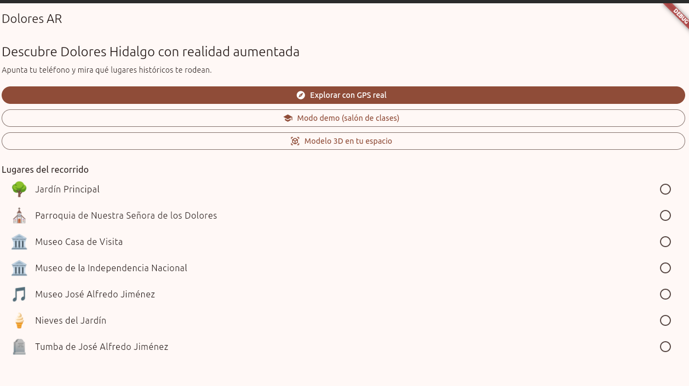
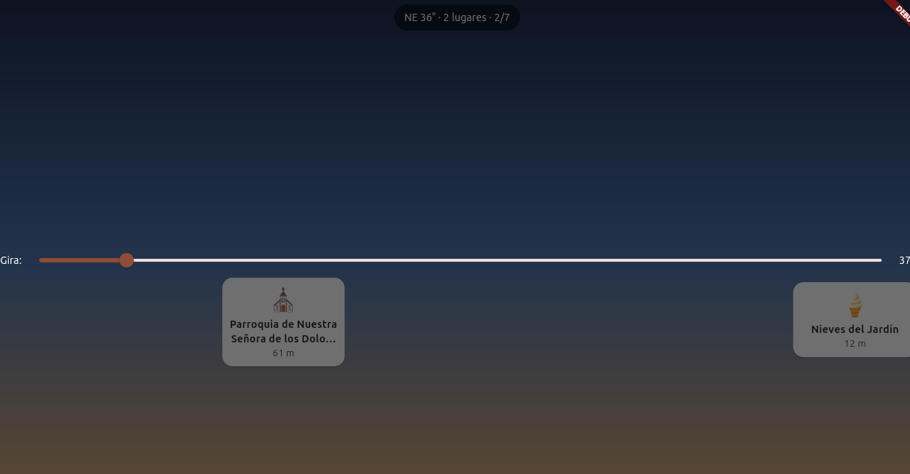
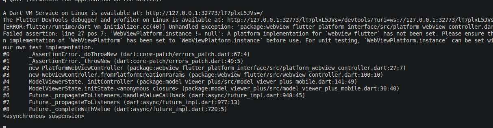
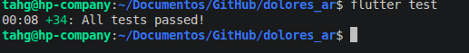

# dolores_ar

A new Flutter project.

## Getting Started

This project is a starting point for a Flutter application.

A few resources to get you started if this is your first Flutter project:

- [Learn Flutter](https://docs.flutter.dev/get-started/learn-flutter)
- [Write your first Flutter app](https://docs.flutter.dev/get-started/codelab)
- [Flutter learning resources](https://docs.flutter.dev/reference/learning-resources)

For help getting started with Flutter development, view the
[online documentation](https://docs.flutter.dev/), which offers tutorials,
samples, guidance on mobile development, and a full API reference.

# 🚀 Proyecto Flutter

Aplicación de escritorio desarrollada en Flutter y optimizada para ejecutarse en Linux. A continuación se presenta la documentación visual del proyecto.

---

## 🖥️ Interfaz y Demostración

### Pantalla Principal
La vista principal de la aplicación, donde el usuario puede interactuar con las funciones core.
<p align="center">
  
</p>

### Demostración en Acción
Un vistazo rápido a la aplicación en funcionamiento.
<p align="center">
  
</p>

### Vista 3D
<p align="center">
  
</p>

---

## 🧪 Suite de Pruebas (Tests)

El proyecto cuenta con pruebas automatizadas para garantizar el correcto funcionamiento de la lógica y la interfaz.

### Pruebas Pasadas Exitosamente
Todas las pruebas se ejecutan correctamente confirmando la estabilidad del código.
<p align="center">
  
</p>

Para correr las pruebas en tu entorno local, utiliza el siguiente comando:
```bash
flutter test